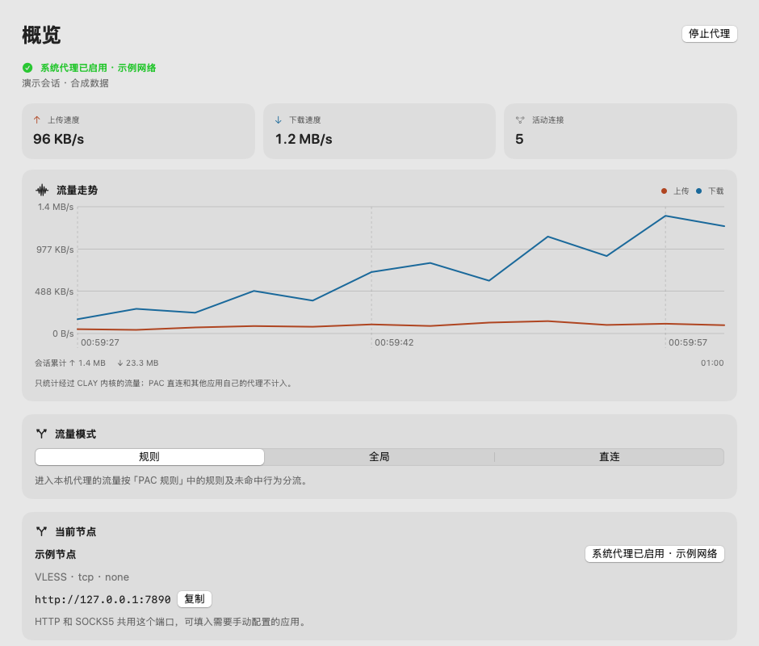
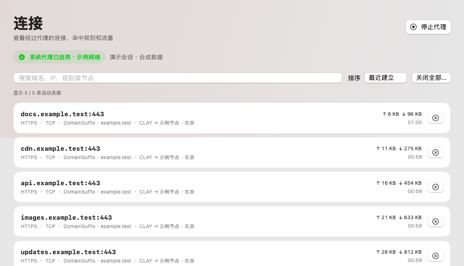

# CLAY

[简体中文](README.md) · [Changelog](CHANGELOG.md) · [GitHub Releases](https://github.com/henwanla/CLAY/releases)

CLAY is a native macOS proxy app with subscriptions, menu bar controls, PAC routing, live traffic, and a connection inspector. The [0.3.4 desktop preview](https://github.com/henwanla/CLAY/releases/tag/v0.3.4) has downloads for Apple Silicon with macOS 13 or later, Windows x64, and Ubuntu 24.04 x86-64. See the platform notes below for mobile previews and their test coverage.

## Screenshots

The macOS Overview shows traffic, the selected node, and the routing mode. The screenshots use synthetic traffic and an example node.



<details>
<summary>Show the Connections view</summary>



</details>

## Getting started

1. **Local preview (build 4 and later):** Open `CLAY.app`. If you have not selected another core, CLAY uses the bundled Mihomo with a pinned fingerprint. To use a different trusted core, choose it in Settings (**设置**). Verify the source and select it again after replacing or upgrading an external core.
2. **GitHub release:** Download `CLAY-0.3.4-macos-arm64.zip` and the matching `.zip.sha256`. In the download directory, run `shasum -a 256 -c CLAY-0.3.4-macos-arm64.zip.sha256` before extracting the ZIP. The public package requires you to install Mihomo separately, as shown below. The app has an ad hoc signature and has no Developer ID signature or notarization. If macOS blocks the package, you can build it from source under your usual security policy.
3. Under Subscriptions (**订阅**), select Add subscription (**添加订阅…**) and enter your provider’s HTTPS link. Under Nodes (**节点**), you can also paste share links or import UTF-8 JSON, YAML, or text files.
4. Choose a node and select Connect macOS (**连接 macOS**) from the main window or menu bar. CLAY starts the local proxy and sets up system PAC for the current primary network service or the service you choose in PAC Rules. For manual setup, use Start local proxy only (**仅启动本机代理**) and enter the HTTP/SOCKS5 address from Overview (**概览**) in the app. If you are still using 0.3.0, use Start (**启动**) and then Apply to macOS (**应用到 macOS**) under PAC Rules.
5. Closing the window keeps CLAY and its proxy running. In new builds, the menu bar also lets you switch nodes and routing modes. Quit CLAY or press `⌘Q` to end the session. CLAY does not launch automatically at login.

In development builds, use **Settings → 使用随附 Mihomo** to switch back to the verified core in the local preview. If an external executable was replaced or moved, the app stays stopped and offers recovery in the window and menu bar. Connect again after choosing the core. The menu bar shows node numbers and protocols; match the number to the full name in the Nodes view.

### Install Mihomo for the public package

From [Mihomo v1.19.34](https://github.com/MetaCubeX/mihomo/releases/tag/v1.19.34), download `mihomo-darwin-arm64-v1.19.34.gz` from the official Assets list. Verify both the archive and the extracted executable:

```sh
(
  set -eu
  echo '1a7a20eca63fbbaec90137717465bfde488d0db2a3a79b8fadebf9b2545b6e4c  mihomo-darwin-arm64-v1.19.34.gz' | shasum -a 256 -c
  mkdir -p "$HOME/.local/bin"
  clay_candidate="$(mktemp "$HOME/.local/bin/.mihomo.XXXXXX")"
  trap 'rm -f "$clay_candidate"' EXIT
  gzip -dc mihomo-darwin-arm64-v1.19.34.gz > "$clay_candidate"
  printf 'a55a9073f9b7b1fa596a82c034d2dae3407ec34732102b6e42c5513ce3033f34  %s\n' "$clay_candidate" | shasum -a 256 -c
  chmod 755 "$clay_candidate"
  mv -f "$clay_candidate" "$HOME/.local/bin/mihomo-v1.19.34"
)
```

Stop if either hash differs. In Settings (**设置**) → Choose Mihomo (**选择 Mihomo…**), press `⌘⇧G`, enter `~/.local/bin`, and select `mihomo-v1.19.34`. Other trusted builds can be selected; the tested core is v1.19.34.

## Routing and app setup

Choose a routing mode from Overview or the menu bar. **Rule** uses the loaded policy from PAC Rules; **Global** uses the selected node; **Direct** connects to the destination without a node. Connect macOS sends non-local requests to the core, so switching modes takes effect without changing macOS proxy settings again. Starting with 0.3.3, changing nodes or modes closes existing connections tracked by the core so apps can reconnect. Reselecting the active option keeps connections open. Traffic that bypasses the proxy is unaffected. Loopback, local names, and private addresses bypass this system connection. Restart the proxy to load edited rules.

| Mode | How to use it | Scope |
| --- | --- | --- |
| Manual connection | Start CLAY and manually enter its HTTP/SOCKS5 address in an app. | Only apps configured with that address; macOS settings stay as they were. |
| Local PAC | Under PAC Rules, select Start local PAC (**启动本机 PAC**), then copy its loopback URL to a PAC-capable app. | Only apps configured with that PAC URL; macOS settings stay as they were. |
| System proxy | Select Connect macOS (**连接 macOS**). You can choose the network service in PAC Rules. | Apps that use the macOS proxy follow the current routing mode. The service’s other proxy settings are temporarily disabled. |
| Custom system PAC | In PAC Rules, select Apply custom PAC (**应用自定义 PAC**). | Direct PAC matches bypass the core. Select Follow routing mode (**跟随流量模式**) to switch back. |

Rules run from top to bottom. The first match wins; unmatched traffic uses your chosen Direct or Proxy default. The initial default is Proxy. Loopback is always direct. Explicit rules can override the optional local and private address bypass. Rules match exact domains or IPs, domain suffixes, domain keywords, and IPv4 CIDR ranges. Development builds add IPv6 CIDR ranges. CIDR rules match destination IPs without a DNS lookup. IPv4-mapped addresses such as `::ffff:192.0.2.7` use IPv4 rules. Enter a domain, IP, or URL to see which rule matches. Paste rules one per line to append them in bulk, for example:

```text
DOMAIN,docs.example.com,DIRECT
DOMAIN-SUFFIX,example.com,PROXY
IP-CIDR,10.0.0.0/8,DIRECT
IP-CIDR6,2001:db8:1234::/48,PROXY
```

Rule edits are saved locally. Select Update to apply edits to a running custom system PAC or local PAC. The local PAC URL changes when you update it, so copy the new URL into manually configured apps. CLAY saves the previous proxy settings for the selected network service before applying system PAC. Use Restore original settings (**恢复原系统设置**) to turn it off; CLAY also tries to restore the previous settings when you stop or quit. macOS may request administrator authorization on apply or restore. After a forced exit, reopen CLAY and use Restore original network proxy settings (**恢复原网络代理设置**) if prompted. If another tool has taken over, CLAY leaves its settings in place.

When CLAY shows **系统代理已启用**, the default macOS proxy points to CLAY. If **未成为系统默认** persists, restore the original settings and reconnect on the current network. To verify traffic, choose Connect macOS and Global, open a public site in a browser that honors macOS proxy settings, and check Connections or the traffic counters.

## Dashboards, subscriptions, and diagnostics

- **Overview** shows upload and download rates, a short traffic history, session totals, and active connection count. **Connections** can filter by destination, rule, or route; sort by time or transfer size; and close one connection or all connections. Connection data is used in the current session. Traffic routed directly by PAC bypasses the core and does not count toward the totals.
- **Subscriptions** can be added, manually refreshed, selected, or removed. A failed refresh keeps the last usable list. Changes apply after restarting the proxy. New builds migrate the old JSON to an encrypted cache and keep its key in a separate private local directory. A process or backup with access to both can still read the subscriptions. Do not edit the migrated cache with an older build. Subscription downloads follow same-origin redirects; for a move to another site, use the trusted final URL. Manual imports last until you quit the app.
- **Diagnostics** can compare two rounds of node probes and copy a report without node names, server addresses, UUIDs, subscription URLs, or raw configuration. Probes send a request through the node to a 204 endpoint at gstatic.com.

**Compatibility:** VMess and VLESS share links, Base64 lists, V2Ray/Xray JSON outbounds, Shadowsocks SIP002 (legacy AEAD and Shadowsocks 2022), TCP/TLS Trojan, Hysteria2 (`hysteria2://` or `hy2://`), TUIC v5 (`tuic://`), and inline `proxies` from Clash/Mihomo YAML or JSON. A subscription has a 2 MiB download limit and can import up to 100 compatible nodes. CLAY does not run imported providers, policy groups, rules, DNS, inbounds, or TUN settings.

Shadowsocks 2022 supports AES-128-GCM, AES-256-GCM, and ChaCha20-Poly1305 from `ss://` links and inline Clash profiles. Keys must use standard Base64 at the cipher’s required length. AES also accepts colon-separated server and user keys. CLAY does not run plugin parameters.

The development build adds Hysteria2 with a fixed port, SNI, Salamander, and Gecko. Share links default to port 443 and require TLS certificate validation. Links with `insecure=1`, `pinSHA256`, port hopping, or Realms are not imported. Inline Clash/Mihomo Hysteria2 and Trojan nodes can provide a SHA-256 `fingerprint` to use Mihomo's native certificate pinning. Shadowsocks plugins and Trojan settings that bypass certificate validation are not imported.

TUIC v5 in development builds requires a UUID, password, and port. It supports SNI, ALPN, congestion control, and `native` or `quic` UDP relay. Share links use standard TLS validation; inline Clash/Mihomo nodes can also use Mihomo's native SHA-256 `fingerprint`. Imports reject TUIC v4 tokens, disabled SNI, skipped certificate verification, and 0-RTT.

## Build and verify

```sh
bash scripts/swift-local.sh build -c release
.build/release/CLAYCoreChecks
python3 scripts/smoke-subscriptions.py .build/release/CLAYCoreChecks
```

`clay-portable` validates local node files and generates PAC. On macOS and Linux it can read summary counters from a specified local Mihomo controller. Linux and Windows can run a verified Mihomo binary in the foreground for manual proxy setup. It leaves system proxy settings alone and does not fetch subscription or provider URLs embedded in input. See the [platform roadmap](docs/跨平台路线.md) for usage and test coverage.

The [downloadable GTK desktop preview](Platforms/Linux/README.md#download-for-ubuntu-2404-x86-64--下载试用包) for Ubuntu 24.04 x86-64 runs without a Swift installation. It offers a manual proxy, desktop PAC with restoration for GNOME and Plasma 6, and manually refreshed HTTPS subscriptions with encrypted caching. Switch nodes and routing modes in the window or tray. With a working tray, closing the window keeps a running session active.

The [Windows x64 desktop preview](Platforms/Windows/README.md#download-for-windows-x64--下载试用包) offers a manual loopback proxy, optional Windows PAC with restoration, and manual HTTPS subscription refresh with encrypted caching. Its tray icon keeps the session accessible after the window is closed and offers node and mode switching.

The [Android ARM64 offline preview](Platforms/Android/README.md) checks profiles and PAC rules in Simplified Chinese, English, and Japanese. The debug APK passed tests on an Android API 24 ARM64 emulator. It has no network permission or VPN support.

The [Android local relay preview](Platforms/Android/README.md#本机代理预览--local-relay-preview) uses a separate app ID. Clients that accept authenticated HTTP or SOCKS5 proxies can connect manually over loopback. The app can switch nodes and Rule, Global, or Direct mode. Only clients configured with the manual proxy are affected.

The separate [Android VPN technical preview](Platforms/Android/README.md#vpn-技术预览--vpn-technical-preview) is a development APK with IPv4 and IPv6 system routing, a foreground service, and node and mode switching. Its Quick Settings tile opens CLAY or stops the running VPN. The notification shows the tunnel phase without exposing profile details, and an old notification cannot stop a restarted session. Relay and VPN both support [manual HTTPS subscription refresh with encrypted node caching](Platforms/Android/README.md#订阅--subscriptions). The Android 15 emulator checks dual-stack TCP and system resolution through IPv4 or IPv6 DNS, node switching, IP rules, and HTTP/TLS domain rules on selected TCP ports. Physical devices, network switching, and encrypted DNS need more testing. There is no public VPN APK yet.

[iOS and iPadOS](Platforms/iOS/README.md) have an offline profile checker and a separate CLAY Tunnel Lab. The lab has an encrypted subscription cache, routes one chosen IPv4 or IPv6 TCP test endpoint, and supports changing the node and mode while connected. It claims only the selected address, forwards only the selected port, and leaves system DNS and default routes alone. It still needs testing on a signed physical device.

[Contributing](CONTRIBUTING.md) · [Verification record](docs/验收记录.md) · [Release process](docs/RELEASING.md) · [Security maintenance](docs/安全维护.md)

Original CLAY code uses the [MIT License](LICENSE). Yams and libyaml have [separate upstream license notices](https://github.com/henwanla/CLAY/blob/main/Vendor/Yams/UPSTREAM.md). Mihomo is a standalone GPL dependency. The local preview keeps its license and pinned upstream source reference; the public ZIP does not redistribute it.
