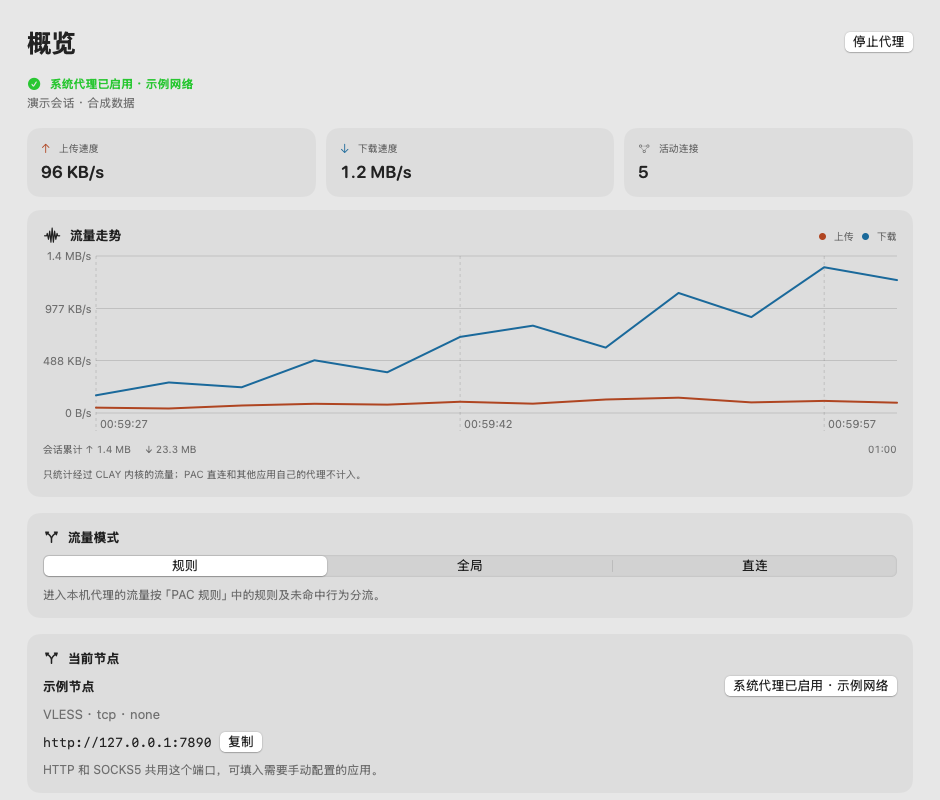
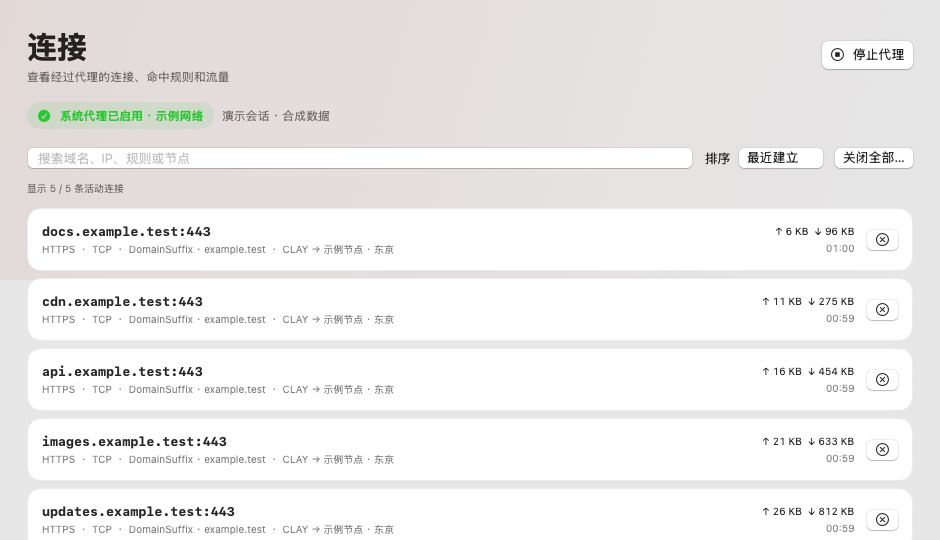

# CLAY

[English](README.en.md) · [更新记录](CHANGELOG.md) · [GitHub Releases](https://github.com/henwanla/CLAY/releases)

CLAY 是原生 macOS 代理客户端，把节点、订阅、菜单栏、PAC 分流和实时连接仪表放在同一个应用里。[0.3.3 桌面预览](https://github.com/henwanla/CLAY/releases/tag/v0.3.3)提供 Apple Silicon（macOS 13 起）、Windows x64 和 Ubuntu 24.04 x86-64 下载。移动端的预览和验证范围见文末。

## 界面截图

macOS「概览」中的流量走势、当前节点和模式切换。截图使用示例节点和合成流量。



<details>
<summary>查看「连接」页</summary>



</details>

## 安装与开始使用

1. **本机预览包（构建号 4 起）**：打开 `CLAY.app`，未选择其他内核时，CLAY 会使用 App 内附带且已固定指纹的 Mihomo。可在「设置 → 选择 Mihomo…」选其他可信版本；升级或替换外部内核后请校验来源并重新选择。
2. **GitHub 安装包**：下载 `CLAY-0.3.3-macos-arm64.zip` 和同名的 `.zip.sha256`。在下载目录执行 `shasum -a 256 -c CLAY-0.3.3-macos-arm64.zip.sha256`，校验通过后解压。公开包没有附带 Mihomo，请按下文安装并在「设置 → 选择 Mihomo…」中选中它。App 使用临时签名，未经过 Developer ID 签名和公证；如果系统禁止打开，可从源码构建，并遵守本机安全策略。
3. 在「订阅」点「添加订阅…」，粘贴服务商提供的 HTTPS 地址；也可以从「节点」粘贴分享链接，或导入 UTF-8 的 JSON、YAML 和文本文件。
4. 选择节点，在主窗口或菜单栏点「连接 macOS」。CLAY 会启动本机代理，再给当前主要网络服务（或你在「PAC 规则」中选定的服务）配置系统 PAC。只需要手动接入时，点「仅启动本机代理」并在应用里填写「概览」的 HTTP／SOCKS5 地址。仍在使用 0.3.0 时，需先点「启动」，再到「PAC 规则」点「应用到 macOS」。
5. 关闭窗口后代理继续运行。新版的 macOS 菜单栏可直接切换节点和流量模式，也能复制地址、重新打开窗口或启停代理。「退出 CLAY」或 `⌘Q` 会结束会话；应用不会在登录 macOS 后自动启动。

开发版可在「设置 → 使用随附 Mihomo」回到试用包内已校验的内核。如果外部文件被替换或移动，连接会保持停止，窗口和菜单栏会显示恢复入口。选好内核后，再点「连接 macOS」。菜单栏只显示节点编号和协议；可在「节点」页用同一编号找到完整名称。

### 为公开安装包准备 Mihomo

从 [Mihomo v1.19.34 官方发布](https://github.com/MetaCubeX/mihomo/releases/tag/v1.19.34) 的 Assets 下载 `mihomo-darwin-arm64-v1.19.34.gz`。在下载目录校验压缩文件，再解压到用户目录：

```sh
(
  set -eu
  echo '1a7a20eca63fbbaec90137717465bfde488d0db2a3a79b8fadebf9b2545b6e4c  mihomo-darwin-arm64-v1.19.34.gz' | shasum -a 256 -c
  mkdir -p "$HOME/.local/bin"
  clay_candidate="$(mktemp "$HOME/.local/bin/.mihomo.XXXXXX")"
  trap 'rm -f "$clay_candidate"' EXIT
  gzip -dc mihomo-darwin-arm64-v1.19.34.gz > "$clay_candidate"
  printf 'a55a9073f9b7b1fa596a82c034d2dae3407ec34732102b6e42c5513ce3033f34  %s\n' "$clay_candidate" | shasum -a 256 -c
  chmod 755 "$clay_candidate"
  mv -f "$clay_candidate" "$HOME/.local/bin/mihomo-v1.19.34"
)
```

任一步的摘要不一致就停止。选文件时可按 `⌘⇧G` 输入 `~/.local/bin`，再选 `mihomo-v1.19.34`。也可以选择已信任的其他 Mihomo 可执行文件，兼容性以 v1.19.34 的验证为基准。

## 流量模式和应用接入

在「概览」或菜单栏切换流量模式：**规则**使用「PAC 规则」中已载入的策略，**全局**通过当前节点转发，**直连**直接访问目标。默认的「连接 macOS」会把非本地请求交给内核；切换模式不需要再次修改系统代理。0.3.3 起，实际切换节点或模式后会关闭内核跟踪的已有连接，让应用重新连接；重复选择当前项不会断流。绕过代理的请求不受影响。回环、本地域名和私有地址默认直连。编辑规则后，重启代理即可载入。

| 模式 | 怎么用 | 影响范围 |
| --- | --- | --- |
| 手动接入 | 启动 CLAY 后，在需要的应用里手动填写 HTTP/SOCKS5 地址。 | 仅使用该地址的应用；不修改 macOS 网络设置。 |
| 本机 PAC | 「PAC 规则 → 启动本机 PAC」，复制回环地址到支持 PAC 的应用。 | 仅使用该 PAC 地址的应用；不修改 macOS 网络设置。 |
| 系统代理 | 点「连接 macOS」，可在「PAC 规则」选择网络服务。 | 支持系统代理的应用跟随流量模式。启用期间暂时关闭该服务的其他代理方式。 |
| 自定义系统 PAC | 在「PAC 规则」点「应用自定义 PAC」。 | 使用自定义 PAC 预先分流，匹配直连的请求不进入内核。「跟随流量模式」可切回默认接入。 |

规则从上到下，命中第一条后停止；未命中时由你选择直连或代理，初始设置为代理。支持完整域名/IP、域名后缀、域名关键词、IPv4 网段；IP 网段只匹配明确写出的 IPv4 地址，不触发 DNS 查询。回环地址始终直连；开启「本地和私有地址直连」后，显式规则仍可覆盖这一默认行为。可输入域名、IP 或 URL 预览命中结果。批量导入采用以下格式，每行一条，追加到列表末尾：

```text
DOMAIN,docs.example.com,DIRECT
DOMAIN-SUFFIX,example.com,PROXY
IP-CIDR,10.0.0.0/8,DIRECT
```

规则编辑后会在本机保存；自定义系统 PAC 和本机 PAC 需分别点「更新」才生效。本机 PAC 更新后为新地址，请重新复制到手动配置的应用。应用到 macOS 前，CLAY 会保存所选网络服务的原代理设置。停用系统 PAC 可点「恢复原系统设置」；正常停止或退出时 CLAY 也会尝试恢复。应用或恢复时 macOS 可能要求管理员授权。如恢复失败，应用会提示处理；强制退出后重开 CLAY，从「PAC 规则」或菜单栏点「恢复原网络代理设置」。如果其他工具已经接管设置，CLAY 会保留对方的设置。

显示「系统代理已启用」时，macOS 的默认代理设置已指向 CLAY。如果持续显示「未成为系统默认」，请在「PAC 规则」恢复原设置，为当前网络重新连接。验证时，选择「连接 macOS」和「全局」，用遵循系统代理设置的浏览器新开一个公开网站，查看「连接」或流量计数。

## 仪表、订阅与诊断

- **概览**显示实时上传和下载速度、短时曲线、本次会话累计量和活动连接数。**连接**可按目标、命中规则或代理链搜索，按时间或流量排序，并关闭单条或全部连接。连接信息只用于当前会话显示；PAC 直连流量不经过内核，因此不会计入。
- **订阅**可以保存多份，手动刷新、切换使用或移除。刷新失败保留上次成功的缓存；运行中变更订阅后，当前会话使用原列表，重新启动代理时应用新列表。新版会将旧 JSON 迁移成加密缓存，并将密钥单独保存到本机私有目录。请勿分享整个 CLAY 数据目录或备份；可以读取密钥的本机账户进程仍能解密。迁移后不要在旧版中编辑同一份订阅。订阅只跟随同源重定向；跨站跳转请直接填写可信的最终地址。手动导入只保留到本次应用退出。
- **诊断**可探测当前或全部节点，比较两次批量测试，复制不含节点名、服务商地址、UUID、订阅链接和原始配置的诊断报告。探测会通过节点请求 gstatic.com 的 204 地址。

**兼容范围**：VMess/VLESS 分享链接、Base64 链接列表、V2Ray/Xray JSON 出站、Shadowsocks SIP002（常见 AEAD 密码套件）、TCP/TLS Trojan、Hysteria2（`hysteria2://` 或 `hy2://`）、TUIC v5（`tuic://`），以及 Clash/Mihomo YAML 或 JSON 的内联 `proxies`。每次下载上限 2 MiB，每份最多导入 100 个兼容节点；本机回环测试允许 HTTP。CLAY 只导入兼容的节点，不执行配置里的提供器、策略组、规则、DNS、TUN 或入站。

开发版的 Hysteria2 支持固定端口、SNI、Salamander 和 Gecko。分享链接省略端口时使用 443，并要求通过 TLS 证书验证；带 `insecure=1`、`pinSHA256`、端口跳跃或 Realms 的链接不导入。Clash/Mihomo 内联的 Hysteria2 和 Trojan 节点可以显式提供 SHA-256 `fingerprint`，此时使用 Mihomo 自身的证书固定机制。Shadowsocks 插件和跳过 Trojan 证书验证的设置不导入。

开发版的 TUIC v5 需要 UUID、密码和端口，支持 SNI、ALPN、拥塞控制与 `native`／`quic` UDP 中继。分享链接使用正常 TLS 证书验证；内联 Clash/Mihomo 节点还可指定 Mihomo 原生 SHA-256 `fingerprint`。不导入 TUIC v4 令牌、禁用 SNI、跳过证书验证或开启 0-RTT 的配置。

## 源码与验证

```sh
bash scripts/swift-local.sh build -c release
.build/release/CLAYCoreChecks
python3 scripts/smoke-subscriptions.py .build/release/CLAYCoreChecks
```

便携工具 `clay-portable` 可检查本地节点文件和生成 PAC；macOS/Linux 还可查看指定本机 Mihomo 的流量汇总。Linux 和 Windows 可前台运行经 SHA-256 核对的 Mihomo，供应用手动接入。它不会修改系统代理或执行输入文件里的订阅与规则提供器链接。使用方法和验证范围见[跨平台计划](docs/跨平台路线.md)。

Linux 有可下载的 [Ubuntu 24.04 x86-64 GTK 桌面预览](Platforms/Linux/README.md#download-for-ubuntu-2404-x86-64--下载试用包)，无需安装 Swift。它支持手动代理、GNOME 和 Plasma 6 的系统 PAC，可手动刷新 HTTPS 订阅并加密缓存。可从窗口或托盘切换节点与模式；托盘可用时，运行中关闭窗口会保留会话。

[Windows x64 桌面预览](Platforms/Windows/README.md#download-for-windows-x64--下载试用包)支持手动接入和 Windows PAC，也可手动刷新 HTTPS 订阅并加密保存节点。关闭窗口后保留托盘入口，支持切换节点和规则／全局／直连。

[Android ARM64 离线预览](Platforms/Android/README.md)可检查节点和 PAC 规则，支持简体中文、英文和日文。它没有联网权限，也不提供 VPN；调试 APK 已在 Android API 24 ARM64 模拟器验收。

[Android 本机代理预览](Platforms/Android/README.md#本机代理预览--local-relay-preview)使用独立应用 ID。它可为支持认证 HTTP/SOCKS5 代理的应用提供手动回环接入、节点切换及规则／全局／直连。它只代理手动配置过的应用。

[Android VPN 技术预览](Platforms/Android/README.md#vpn-技术预览--vpn-technical-preview)是独立的调试 APK，支持 IPv4 系统接管、前台服务、节点和模式切换，也可从快捷设置磁贴打开 CLAY 或停止 VPN。本机代理和 VPN 都支持[手动刷新 HTTPS 订阅并加密缓存节点](Platforms/Android/README.md#订阅--subscriptions)。在 Android 15 模拟器上已验证 IP 规则、部分 TCP 端口的 HTTP/TLS 域名规则和普通 UDP DNS；仍需验证真机、切网和加密 DNS。暂未提供公开 VPN 安装包。

[iOS / iPadOS](Platforms/iOS/README.md)提供离线节点检查和单独的 CLAY 隧道实验。实验支持加密订阅缓存、指定一个 IPv4/TCP 测试端点及连接中切换节点和模式。它只接管一个 IPv4 地址，尚待签名真机验证。

[参与开发](CONTRIBUTING.md) · [架构调研](docs/架构调研.md) · [验收记录](docs/验收记录.md) · [打包及发布](docs/RELEASING.md) · [安全维护](docs/安全维护.md)

CLAY 原创代码以 [MIT](https://github.com/henwanla/CLAY/blob/main/LICENSE) 许可发布。Yams 和 libyaml 各有 [上游许可证](https://github.com/henwanla/CLAY/blob/main/Vendor/Yams/UPSTREAM.md)。Mihomo 是按其 GPL 许可发布的独立依赖；本机预览包附有其许可证和固定版本的源码入口，公开 ZIP 不含该内核。
